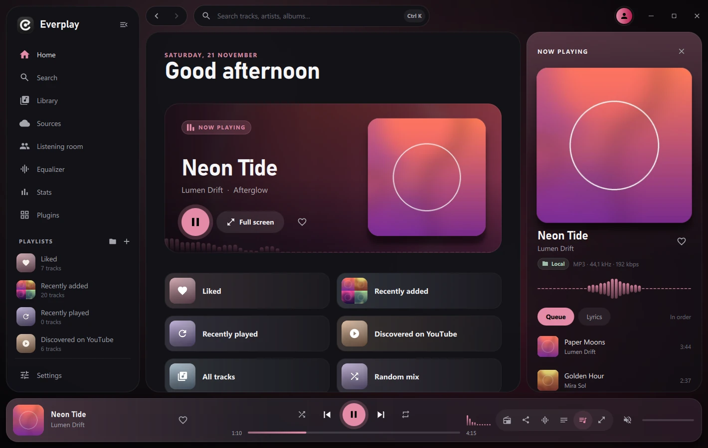
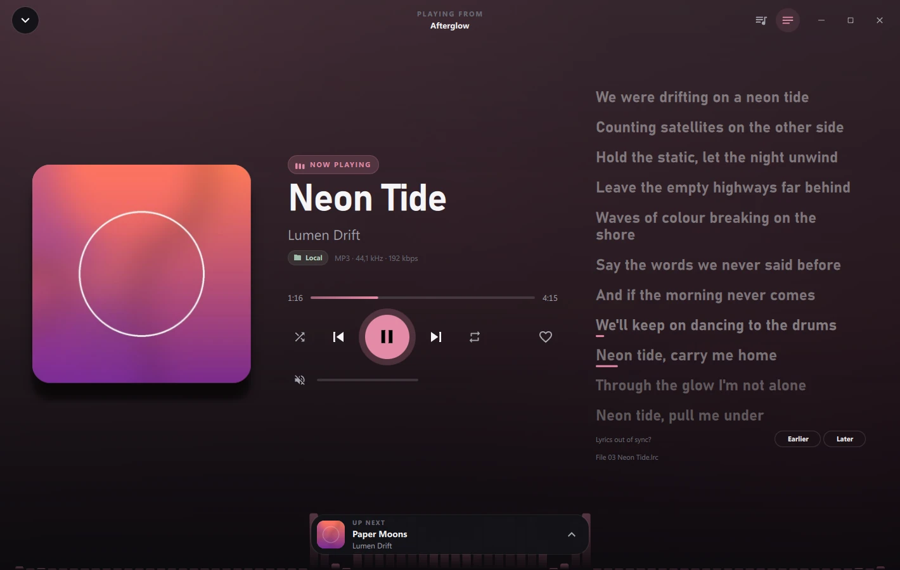
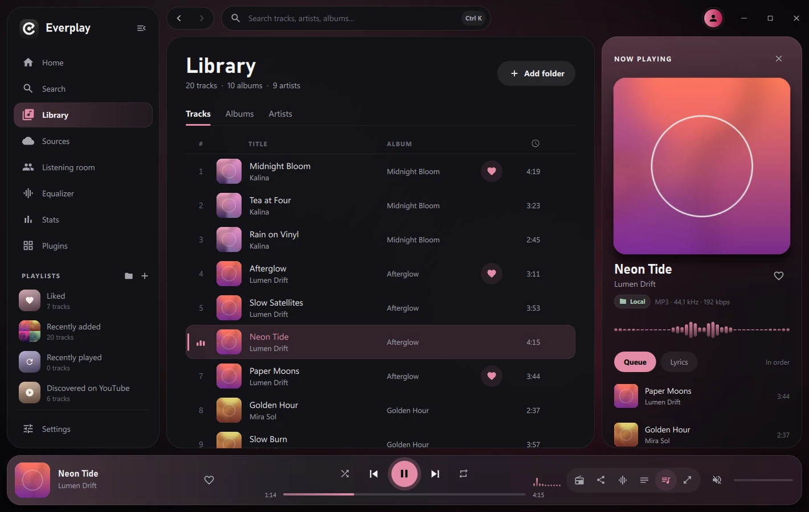
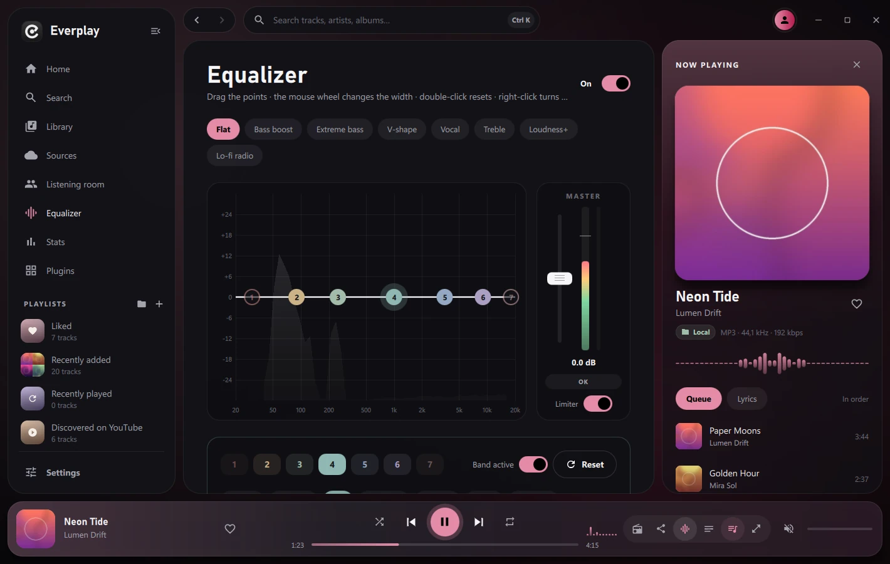

<h1 align="center">Everplay</h1>

  <b>One music player for your files, YouTube Music, Spotify and SoundCloud.</b> 
  Synced lyrics, DJ-style transitions, a real spectrum, themes and listening rooms with friends. 
  Free, for Windows, Linux, Android and the browser.

  
  
  
  
  

  <a href="https://github.com/zr3mb/everplay/releases/latest"><b>Download</b></a> ·
  <a href="https://everplay.404piwko.wtf"><b>Website</b></a> ·
  <a href="https://everplay.404piwko.wtf/app/"><b>Try it in the browser</b></a> ·
  <a href="docs/DEVELOPMENT.md"><b>Developer guide</b></a>

## Why Everplay

Your music is scattered: some on your disk, some liked on YouTube Music, playlists on Spotify, a few finds on
SoundCloud. Everplay puts all of it in **one library with one queue**, and plays it in a player that is
pleasant to look at — without ads and without a subscription.

- **Everything in one place.** Local files (MP3, FLAC, ALAC, Opus and more), YouTube Music likes and playlists,
  your Spotify playlists and liked songs, SoundCloud likes, and FLAC albums and concerts from open archives
  (Internet Archive, Wikimedia Commons). Search covers all of them at once.
- **Lyrics that follow the song.** Timed lyrics highlight the current line and scroll with the music; click a
  line to jump there. Word-by-word karaoke timing, and an always-on-top lyrics overlay for games.
- **Transitions like a DJ.** Per-playlist *Mix* with several transition styles (crossfade, filter sweeps and
  more, 2–16 s), or a global crossfade.
- **Sounds the way you want.** A 7-band parametric equalizer with presets and a limiter, a real FFT spectrum
  visualizer and gapless playback.
- **Never runs out.** Start a radio from any track, or let Everplay keep playing similar songs when the queue
  ends. Recommendations on the home screen learn from what you play.
- **Listen together.** Share a track with a link, build a playlist that everyone with the link can add to, or
  open a listening room where friends hear the same queue at the same moment.
- **Make it yours.** Themes, an accent colour taken from the cover, animated wallpapers that move with the music,
  and plugins written in QML.
- **Feels native.** Windows media controls and lock screen, MPRIS on Linux, media keys, Discord "Listening"
  status, listening stats, English and Polish interface, and automatic updates.

<table>
  <tr>
    <td></td>
    <td></td>
  </tr>
  <tr>
    <td align="center">Full-screen player with synced lyrics</td>
    <td align="center">One library for every source</td>
  </tr>
  <tr>
    <td></td>
    <td align="center" valign="middle">
      <i>The music in these screenshots is made up for the demo.</i>  
      <a href="https://everplay.404piwko.wtf"><b>See more on the website →</b></a>
    </td>
  </tr>
  <tr>
    <td align="center">7-band equalizer over a live spectrum</td>
    <td></td>
  </tr>
</table>

## Download

| Platform | Get it | Notes |
|---|---|---|
| **Windows 10 / 11** | [`Everplay-<version>-setup.exe`](https://github.com/zr3mb/everplay/releases/latest) | Installs for your user, no admin rights needed. Updates itself. |
| **Linux** (x86-64) | [`Everplay-<version>-x86_64.AppImage`](https://github.com/zr3mb/everplay/releases/latest) | `chmod +x` and run. Needs `fuse2`. Updates itself. |
| **Android** (arm64) | [APK from the website](https://everplay.404piwko.wtf/download/android) | Allow installing from your browser when asked. |
| **Browser** | [everplay.404piwko.wtf/app](https://everplay.404piwko.wtf/app/) | Nothing to install; works on phones, computers and TVs. |

Every release lists its changes and SHA-256 checksums on the [Releases](https://github.com/zr3mb/everplay/releases)
page.

## Getting started

1. Install and open Everplay. A short setup lets you pick the language, layout and colours.
2. Your system *Music* folder is added automatically; add more under **Sources → Local files**.
3. Optional: sign in to **YouTube Music**, **Spotify** or **SoundCloud** under **Sources** to bring in your
   likes and playlists. Each sign-in happens in your own browser window, and Everplay keeps only what it needs
   to read your library, encrypted on your computer.

Useful shortcuts: <kbd>Space</kbd> play / pause, <kbd>Ctrl</kbd>+<kbd>K</kbd> search,
<kbd>Ctrl</kbd>+<kbd>→</kbd> / <kbd>←</kbd> next / previous track.

## FAQ

**Is it free?** Yes — no ads, no subscription, no account needed for listening.

**Do I need Spotify Premium?** No. Everplay reads your Spotify playlists and liked songs, then plays each track
from its match on YouTube Music. You can pick a different match for any track.

**Is anything sent to a server?** On Windows and Linux your library, listening and sign-ins stay on your
computer. The online features (share links, shared playlists, listening rooms, syncing between your devices)
use the Everplay server, and only once you use one of them. The Android app and the browser version get
YouTube Music audio through that server, because they can't run the tools that do it on a computer.

**Which music sources are "open"?** The open FLAC search only shows music that may be shared freely: the
Internet Archive's Live Music Archive and netlabels, and freely licensed recordings on Wikimedia Commons.

## Contributing

Bug reports and ideas are welcome in [Issues](https://github.com/zr3mb/everplay/issues). To build from source,
see the [developer guide](docs/DEVELOPMENT.md); it also explains how each feature works inside. Plugins
(wallpapers, themes, overlays) are plain QML: see [writing a plugin](docs/plugins.md).

If Everplay is useful to you, **a star on GitHub** helps other people find it.

## License

Everplay is free software under the [GNU General Public License v3.0](LICENSE): you may use, study, share
and change it, and versions you distribute stay under the same license.

---

Everplay is an independent project and is not affiliated with YouTube, Spotify, SoundCloud, Discord,
the Internet Archive or Wikimedia. Built with C++20, Qt 6 (QML) and TagLib.
